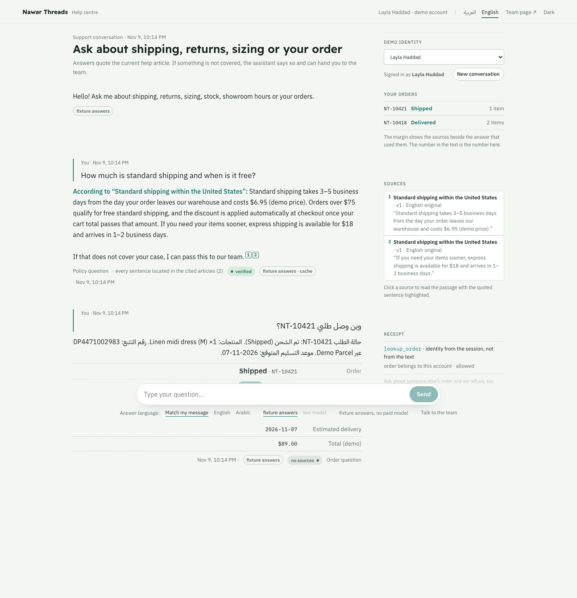

# Bilingual Support

**Answers that know their sources—and their limits.**

A support answer needs both useful evidence and the right permission boundary. This assistant connects bilingual policy questions, scoped order lookup and human handoff.

Built by **Mohammed Abumtary** · TypeScript · React · Hono · PostgreSQL · versioned keyword retrieval

[Demo guide](docs/DEMO.md) · [Engineering notes](docs/ENGINEERING.md) · [Verification & boundaries](docs/VERIFICATION.md) · [Recorded walkthrough](media/walkthrough.webm)

## The experience

Choose a sample identity → ask a policy question → open evidence → test a boundary.

A fictional retailer, selected demo identities and deterministic answers by default. The knowledge base includes Arabic drafts awaiting language review.

## Where the engineering matters

### Verify citations against retrieved passages

A model cannot turn an arbitrary citation into verified evidence. Quotes are located in the retrieved source before they receive verified status.

### Take identity from the session

Order access is decided on the server using the current customer identity, never a customer identifier supplied in the message.

### Version the knowledge, not just the answer

Publishing an article revision invalidates dependent cached answers, marks translations stale and triggers index rebuilding.

## Verified in the demonstration

- 12 database regressions covering English/Arabic policy basis, scoped orders, stale knowledge, citations and handoff.
- Six browser checks passed, including desktop journeys and narrow Arabic layout.
- Recorded chat, evidence drawer and operator workflow available.

## Explore the work

This private repository is a presentation package: screenshots, walkthrough media and engineering notes. Application source, credentials and customer records are not included. The interactive demonstration runs in a separate local review environment; access can be arranged for a walkthrough.

[Read the guided demo](docs/DEMO.md) · [View my portfolio](https://mohammed-ab.github.io/)

## Scope

The default experience uses sample customers and policy fixtures. Arabic content remains a draft pending language review. No real store integration is connected.

Reviewed 10 November 2026. Results describe the recorded build and stated test scope.
